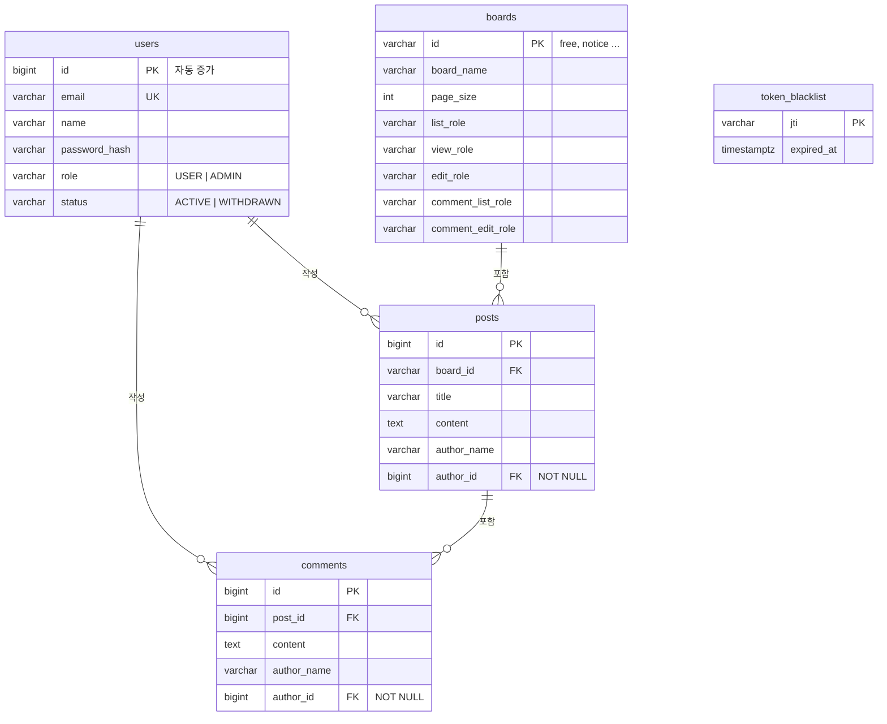
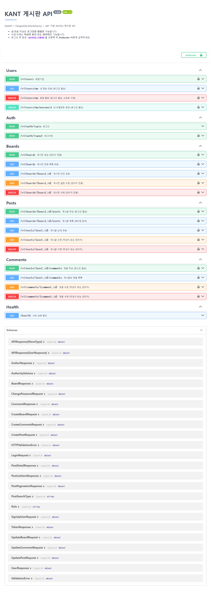

# KANT 게시판 API

KANT 백엔드 아키텍처 & API 설계 과제입니다. FastAPI로 만든 **RESTful 게시판 API**이며, PostgreSQL + SQLAlchemy(비동기)로 데이터를 관리하고 JWT로 인증·인가를 처리합니다.

- 글·댓글 작성은 **로그인한 회원만** 가능합니다. (비회원 작성 미지원)
- 수정·삭제는 **작성자 본인 또는 관리자**만 가능합니다.
- 게시판마다 목록·상세·글쓰기·댓글 권한(`ALL` / `USER` / `ADMIN`)을 설정할 수 있습니다.

## 1. 기술 스택

| 구분 | 기술 |
| --- | --- |
| 언어 / 패키지 관리 | Python 3.13, uv |
| 웹 프레임워크 | FastAPI, Uvicorn |
| 데이터 검증 | Pydantic v2 (`EmailStr` 포함) |
| DB / ORM | PostgreSQL, SQLAlchemy 2.x (asyncpg, 커넥션 풀) |
| 인증 | JWT (PyJWT, HS512, `jti` 블랙리스트 로그아웃), bcrypt 비밀번호 해싱 |
| 문서화 | OpenAPI / Swagger UI (`/docs`) |

## 2. 아키텍처

도메인(user, auth, board)별로 4계층으로 나누고, 계층 간 의존성은 `wiring/`에서 FastAPI `dependency_overrides`로 연결합니다.

```text
src/
├── main.py                     # 앱 생성, 예외 핸들러·DI·라우터 등록, 기본 데이터 준비
├── wiring/                     # 의존성 주입: presentation 의 provide_* → 실제 구현 연결
│   ├── user.py  auth.py  board.py
├── shared/core/                # 공통 모듈
│   ├── database.py             # 비동기 엔진, 커넥션 풀, 요청 단위 세션(get_db: commit/rollback)
│   ├── models.py               # Base, 생성·수정·삭제 시각 공통 컬럼
│   ├── exceptions.py           # 400/401/403/404/409/422 공통 예외
│   ├── exception_handlers.py   # 모든 에러를 같은 형식(APIResponse)으로 응답
│   ├── schemas.py              # APIResponse.ok / fail
│   └── logger.py
├── user/                       # 회원 (가입, 내 정보, 비밀번호 변경, 탈퇴)
├── auth/                       # 로그인, 로그아웃(토큰 블랙리스트)
└── board/                      # 게시판 설정, 게시글, 댓글
    ├── domain/                 # 엔티티(Board, Post, Comment), 권한 규칙, 저장소 인터페이스
    ├── application/            # 서비스: 권한 확인 → 도메인 로직 → 저장
    ├── infrastructure/sqlalchemy/  # ORM 모델, 매퍼, 저장소 구현
    └── presentation/           # 라우터, 요청·응답 스키마, 의존성 자리표시자
```

| 계층 | 역할 |
| --- | --- |
| presentation | HTTP 요청·응답, Pydantic 스키마, 라우팅 |
| application | 유스케이스 흐름 조율 (게시판 권한, 작성자 검증) |
| domain | 핵심 규칙 (제목·내용 검증, 작성자 본인 확인, 소프트 삭제) |
| infrastructure | SQLAlchemy 모델과 저장소 구현, bcrypt, JWT |

## 3. ERD



- 모든 PK는 DB 자동 증가 정수(`BIGINT`)입니다. 단, `boards.id`는 URL에 쓰는 문자열(`free` 등), `token_blacklist.jti`는 토큰마다 무작위로 만드는 UUID 문자열입니다.
- 회원 탈퇴는 `status`를 `WITHDRAWN`으로 바꾸고 `deleted_at`을 기록합니다.
- `token_blacklist`를 뺀 모든 테이블에 `created_at`, `modified_at`, `deleted_at`(소프트 삭제)이 있습니다. 컬럼별 상세 설명은 [docs/ERD.md](docs/ERD.md)에 있습니다.

## 4. API 명세

Swagger UI: `http://<서버 주소>:8000/docs`



| 구분 | 메서드 | 경로 | 인증 | 설명 |
| --- | --- | --- | --- | --- |
| 회원 | POST | `/v1/users` | ✕ | 회원가입 |
| | GET | `/v1/users/me` | 회원 | 내 정보 |
| | PATCH | `/v1/users/me/password` | 회원 | 비밀번호 변경 |
| | DELETE | `/v1/users/me` | 회원 | 탈퇴 (소프트 삭제) |
| 인증 | POST | `/v1/auth/login` | ✕ | 로그인 → JWT 발급 |
| | POST | `/v1/auth/logout` | 회원 | 토큰 무효화 (블랙리스트 등록) |
| 게시판 | GET | `/v1/boards`, `/v1/boards/{board_id}` | ✕ | 게시판 목록·조회 |
| | POST / PUT / DELETE | `/v1/boards`, `/v1/boards/{board_id}` | **관리자** | 게시판 생성·수정·삭제 |
| 게시글 | GET | `/v1/boards/{board_id}/posts` | 게시판 설정 | 목록 (페이징, 검색) |
| | POST | `/v1/boards/{board_id}/posts` | 회원 | 작성 |
| | GET | `/v1/posts/{post_id}` | 게시판 설정 | 상세 |
| | PUT / DELETE | `/v1/posts/{post_id}` | **작성자·관리자** | 수정·삭제 |
| 댓글 | GET | `/v1/posts/{post_id}/comments` | 게시판 설정 | 목록 |
| | POST | `/v1/posts/{post_id}/comments` | 회원 | 작성 |
| | PUT / DELETE | `/v1/comments/{comment_id}` | **작성자·관리자** | 수정·삭제 |

목록 검색: `?page=1&page_size=20&search_type=TITLE&keyword=검색어` (`search_type`: `ALL`, `TITLE`, `CONTENT`, `TITLE_CONTENT`, `AUTHOR_NAME`, `AUTHOR_EMAIL`)

### 인증 흐름

1. `POST /v1/auth/login` → `access_token` 발급 (HS512, 기본 60분, `jti` 포함)
2. 요청 헤더에 `Authorization: Bearer <access_token>` (Swagger는 오른쪽 위 **Authorize**)
3. `POST /v1/auth/logout` → 토큰의 `jti`를 `token_blacklist`에 저장, 이후 같은 토큰은 401
4. 탈퇴한 회원은 로그인할 수 없고, 기존 토큰으로 요청해도 403

### 에러 응답 형식

모든 에러는 같은 형식으로 응답합니다.

```json
{
  "success": false,
  "code": "FORBIDDEN",
  "message": "본인이 작성한 게시글만 수정할 수 있습니다.",
  "errors": null,
  "data": null,
  "responded_at": "2026-11-15T05:00:00Z"
}
```

| 상태 코드 | code | 상황 |
| --- | --- | --- |
| 401 | `UNAUTHORIZED` | 로그인 필요, 토큰 위조·만료·로그아웃 |
| 403 | `FORBIDDEN` | 작성자 아님, 관리자 아님, 게시판 권한 부족 |
| 404 | `NOT_FOUND` | 없는 게시판·글·댓글 |
| 409 | `EMAIL_ALREADY_EXISTS` | 이메일 중복 가입 |
| 422 | `REQUEST_VALIDATION_ERROR` / `VALIDATION_ERROR` | 입력값 형식 오류 / 도메인 규칙 위반 (필드별 메시지는 `errors`) |

## 5. 실행 방법

```bash
uv sync
cp .env.example .env      # DATABASE_URL, JWT_SECRET_KEY, ADMIN_* 입력
uv run uvicorn main:app --app-dir src --host 0.0.0.0 --port 8000
```

- 서버가 시작되면 테이블을 자동 생성하고, 기본 게시판 `free`(자유게시판)와 `.env`의 관리자 계정을 만듭니다.
- 관리자 비밀번호도 회원 비밀번호 규칙(8자 이상, 영문·숫자·특수문자)을 따라야 합니다.

## 6. 동작 검증

서버를 띄운 뒤 시나리오 스크립트를 실행합니다.

```bash
uv run --with httpx python scripts/smoke_test.py http://localhost:8000
```

로컬 PostgreSQL 환경에서 **38개 시나리오 전부 통과**했습니다.

| 영역 | 확인 내용 |
| --- | --- |
| 회원가입 | 정상 가입, 이메일 중복 409, 약한 비밀번호·이메일 형식 422 |
| 로그인 | 틀린 비밀번호 401, 토큰 없음·위조 토큰 401 |
| 게시글 | 비로그인 작성 401, 작성·목록·검색·상세, 없는 글·게시판 404, **다른 회원 수정·삭제 403**, 본인·관리자 수정 |
| 댓글 | 비로그인 작성 401, **다른 회원 댓글 수정 403**, 본인 수정·삭제 |
| 게시판 관리 | 일반 회원 생성 403, 관리자 생성·삭제, 글쓰기 권한 `ALL` 설정 422 |
| 로그아웃·탈퇴 | 로그아웃 토큰 재사용 401, 비밀번호 변경, 탈퇴 후 로그인 401 |

## 7. 배포 (AWS EC2)

PostgreSQL은 EC2 안에서 Docker 컨테이너로 실행하고, FastAPI는 같은 EC2에서 uv로 실행합니다.

```bash
# 1) .env 작성 (POSTGRES_PASSWORD 와 DATABASE_URL 의 비밀번호를 같은 값으로)
cp .env.example .env

# 2) PostgreSQL 컨테이너 실행 (127.0.0.1:5432 에만 열림, 외부에서 DB 직접 접속 불가)
docker compose up -d
docker compose ps          # STATUS 가 healthy 인지 확인

# 3) API 서버 실행
uv sync
uv run uvicorn main:app --app-dir src --host 0.0.0.0 --port 8000
```

- [ ] EC2 인스턴스 생성, 보안 그룹에서 8000(또는 80) 포트 열기 (**5432는 열지 않음**)
- [ ] Docker 설치 후 `docker compose up -d`
- [ ] `.env` 작성 → uvicorn 실행 (systemd 서비스 등록)
- [ ] 배포 주소와 Swagger 주소 기록

## 8. 참고

튜터 프로젝트 [yonggyo1125/backend_project_ax1](https://github.com/yonggyo1125/backend_project_ax1)의 구조(4계층 + wiring)를 기반으로, 비회원 글쓰기를 제거하고 회원 전용 게시판으로 변경했습니다.
