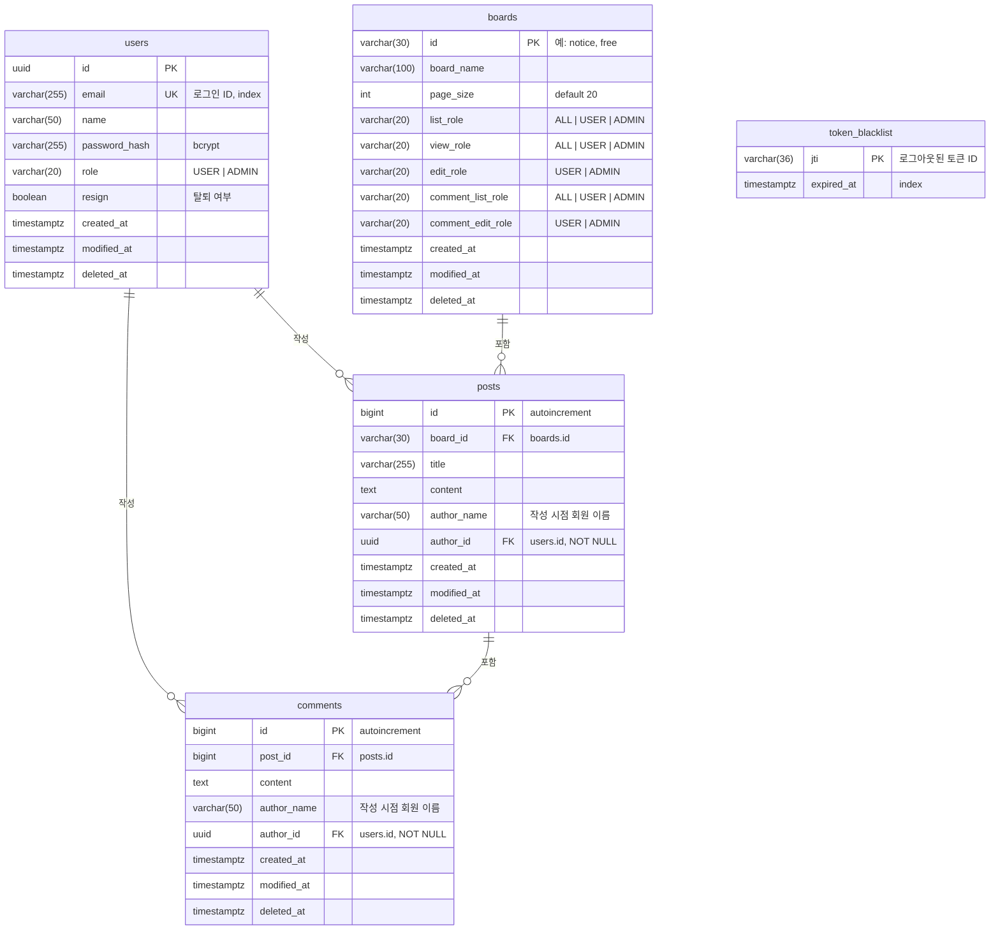

# ERD - 게시판 API

튜터 프로젝트 `yonggyo1125/backend_project_ax1`의 SQLAlchemy 모델 구조를 기준으로 작성했습니다.

> **튜터 구조와 다른 점: 비회원 글쓰기·댓글을 지원하지 않습니다.**
> 글과 댓글은 로그인한 회원만 작성할 수 있으므로 `author_id`는 NOT NULL이고, 비회원용 `guest_password` 컬럼은 없습니다.
> 목록과 상세 보기는 게시판 권한이 `ALL`이면 비회원도 가능합니다.

## 다이어그램

## 테이블 상세

### users (회원) - `user/infrastructure/models.py`

| 컬럼 | 타입 | 제약조건 | 설명 |
| --- | --- | --- | --- |
| id | UUID | **PK**, 기본값 `uuid4` | 회원 ID |
| email | VARCHAR(255) | NOT NULL, **UNIQUE**, INDEX | 로그인 ID |
| name | VARCHAR(50) | NOT NULL | 이름 (글 작성자명) |
| password_hash | VARCHAR(255) | NOT NULL | bcrypt 해시 |
| role | VARCHAR(20) | NOT NULL, 기본값 `USER` | `USER` / `ADMIN` |
| resign | BOOLEAN | NOT NULL, 기본값 false | 탈퇴 여부 |
| created_at / modified_at / deleted_at | TIMESTAMPTZ | `DateTimeBase` 공통 | 생성·수정·삭제(소프트 삭제) 시각 |

### boards (게시판 설정) - `board/infrastructure/sqlalchemy/models.py`

| 컬럼 | 타입 | 제약조건 | 설명 |
| --- | --- | --- | --- |
| id | VARCHAR(30) | **PK** | 게시판 아이디 (예: `notice`, `free`) |
| board_name | VARCHAR(100) | NOT NULL | 게시판 이름 |
| page_size | INTEGER | NOT NULL, 기본값 20 | 한 페이지 글 수 |
| list_role / view_role | VARCHAR(20) | NOT NULL, 기본값 `ALL` | 목록·보기 권한 (`ALL`이면 비회원도 열람) |
| edit_role | VARCHAR(20) | NOT NULL, 기본값 `USER` | 글쓰기 권한. **`ALL` 사용 안 함** (최소 `USER`) |
| comment_list_role | VARCHAR(20) | NOT NULL, 기본값 `ALL` | 댓글 보기 권한 |
| comment_edit_role | VARCHAR(20) | NOT NULL, 기본값 `USER` | 댓글 쓰기 권한. **`ALL` 사용 안 함** |
| created_at / modified_at / deleted_at | TIMESTAMPTZ | | |

권한 값은 `board/domain/enums.py`의 `Role`(`ALL` < `USER` < `ADMIN`)이며, 상위 권한은 하위 권한을 포함합니다.

### posts (게시글)

| 컬럼 | 타입 | 제약조건 | 설명 |
| --- | --- | --- | --- |
| id | BIGINT | **PK**, autoincrement | 글 번호 |
| board_id | VARCHAR(30) | NOT NULL, **FK → boards.id** | 소속 게시판 |
| title | VARCHAR(255) | NOT NULL | 제목 |
| content | TEXT | NOT NULL | 본문 |
| author_name | VARCHAR(50) | NOT NULL | 작성 시점의 회원 이름 (목록 조회 시 조인 없이 표시) |
| author_id | UUID | **NOT NULL**, **FK → users.id** ON DELETE RESTRICT | 작성한 회원. 수정·삭제 시 작성자 검증 기준 |
| created_at / modified_at / deleted_at | TIMESTAMPTZ | | |

인덱스: `ix_posts_id_deleted_at (id, deleted_at)`, `ix_posts_author_id (author_id)`

### comments (댓글)

| 컬럼 | 타입 | 제약조건 | 설명 |
| --- | --- | --- | --- |
| id | BIGINT | **PK**, autoincrement | 댓글 번호 |
| post_id | BIGINT | NOT NULL, **FK → posts.id** | 소속 게시글 |
| content | TEXT | NOT NULL | 내용 |
| author_name | VARCHAR(50) | NOT NULL | 작성 시점의 회원 이름 |
| author_id | UUID | **NOT NULL**, **FK → users.id** ON DELETE RESTRICT | 작성한 회원 |
| created_at / modified_at / deleted_at | TIMESTAMPTZ | | |

인덱스: `ix_comments_post_id_deleted_at (post_id, deleted_at)`

### token_blacklist (로그아웃 토큰) - `auth/infrastructure/models.py`

| 컬럼 | 타입 | 제약조건 | 설명 |
| --- | --- | --- | --- |
| jti | VARCHAR(36) | **PK**, INDEX | JWT의 고유 ID(`jti` 클레임) |
| expired_at | TIMESTAMPTZ | NOT NULL, INDEX | 토큰 만료 시각 (지난 행은 정리 대상) |

다른 테이블과 FK로 연결되지 않는 독립 테이블입니다. 토큰 문자열 대신 `jti`만 저장합니다.

## 관계

| 관계 | 종류 | 설명 |
| --- | --- | --- |
| boards → posts | 1 : N | 게시판 하나에 글 여러 개 |
| posts → comments | 1 : N | 글 하나에 댓글 여러 개 |
| users → posts | 1 : N (필수) | 모든 글은 작성 회원이 있음 |
| users → comments | 1 : N (필수) | 모든 댓글은 작성 회원이 있음 |

회원 탈퇴는 행을 지우지 않고 `users.resign = true`, `deleted_at`을 기록하는 **소프트 삭제**로 처리합니다. 그래서 FK는 `ON DELETE RESTRICT`로 두어 실수로 회원 행이 지워지며 글이 고아가 되는 것을 막습니다.

## 권한 검증 흐름

| 동작 | 비회원 | 회원 | ADMIN |
| --- | --- | --- | --- |
| 목록·상세 보기 | 게시판 `list_role` / `view_role`이 `ALL`이면 가능 | 권한 `USER` 이상이면 가능 | 가능 |
| 글·댓글 쓰기 | **불가 (401)** | `edit_role` / `comment_edit_role` 충족 시 가능 | 가능 |
| 글·댓글 수정·삭제 | **불가 (401)** | `author_id == 로그인 회원 id`일 때만 (아니면 403) | 모든 글 가능 |
